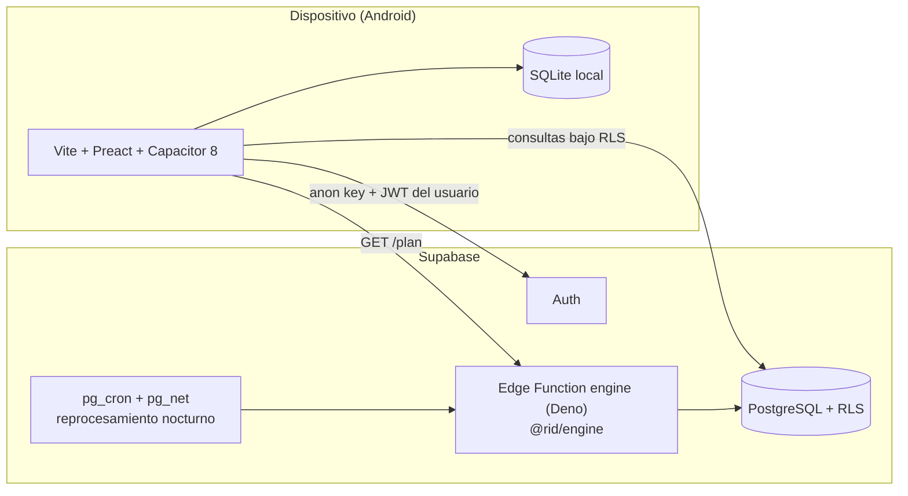

# Proyecto Capstone: RID — RepInDepth

| | |
|---|---|
| **Asignatura / Sección** | 2026_2_MA_CAPSTONE_005D |
| **Grupo** | Grupo 1
| **Institución** | DUOC UC — Sede Maipú |
| **Periodo de ejecución** | 13 de agosto al 27 de noviembre de 2026 (16 semanas) |
| **Metodología** | RUP híbrida, con iteraciones semanales |

---

## Descripción del proyecto

**RID — RepInDepth** es una aplicación móvil de entrenamiento de fuerza cuya diferencia central es que **la persona nunca decide cuánto peso levantar**. Un motor probabilístico en el servidor prescribe la carga, las repeticiones y las semanas de descarga a partir del historial propio de cada usuario. Las series se registran por voz, sin interrumpir el entrenamiento.

El motor combina un filtro de Kalman sobre un modelo de estado de aptitud y fatiga, un modelo bayesiano jerárquico para los priors poblacionales, predicción conforme adaptativa para acotar el riesgo y una decisión con pérdida asimétrica (sobrestimar la carga cuesta más que subestimarla). El sistema **no usa generación de lenguaje ni chatbots**: cada número que ve la persona es la salida directa y auditable de un modelo estadístico.

### Problema que resuelve

Quien entrena sin guía profesional no sabe cuánto peso mover: subestimar detiene el progreso y sobrestimar aumenta el riesgo de lesión. Las aplicaciones de entrenamiento existentes registran series; casi ninguna decide la carga por la persona con una base estadística explícita.

### Beneficio esperado

Una persona que entrena con RID no tiene que saber programar su propia progresión de carga ni arriesgarse a estancarse o lesionarse por una mala estimación propia. El motor lo hace por ella, con un margen de error acotado y ajustado a su historial.

### Alcance

- Aplicación Android (iOS en una fase posterior) para teléfonos y tablets, con arquitectura **local-first**.
- Motor de prescripción probabilística desplegado en el servidor.
- Registro de series por reconocimiento de voz.
- Suscripción con prueba gratuita de 30 días y publicación en Google Play.
- Catálogo de 470 ejercicios con sustitutos equivalentes (1.386 relaciones de sustitución).

La metodología del motor se documenta a nivel metodológico; su implementación es propietaria.

---

## Equipo de trabajo

| Integrante | Rol | Responsabilidades principales |
|---|---|---|
| **Fernando Almonacid** | Líder de proyecto, arquitectura y backend | Arquitectura, motor de prescripción (`@rid/engine`), funciones de borde, decisiones técnicas (ADR) |
| **Bastián Berríos** | Frontend móvil y UX | Aplicación móvil, flujos de usuario, investigación con usuarios, reconocimiento de voz |
| **Favio Pérez** | DevOps, base de datos y QA | Modelo PostgreSQL y migraciones, seguridad RLS, CI/CD, pruebas y verificación |

---

## Arquitectura

Regla central: **el dispositivo solo captura, sincroniza y consulta; el servidor prescribe todo.** Ningún archivo de la aplicación calcula cargas, e1RM ni planes. La aplicación no incluye datos de muestra: cada pantalla consume datos reales y resuelve sus estados de carga, vacío y error.



Aislamiento y seguridad:

- El cliente móvil usa únicamente la clave `anon` y el JWT del usuario, siempre bajo seguridad a nivel de fila (RLS). **No existe `service_role` en el dispositivo.**
- La función de borde separa dos clientes: uno con el JWT del usuario para leer bajo RLS y otro con `service_role` para escribir, verificando antes la propiedad de la sesión.
- La suite de pruebas de RLS cubre los cruces A→B y B→A entre usuarios (51 casos).

---

## Tecnologías utilizadas

### Aplicación móvil (cliente)

| Tecnología | Uso |
|---|---|
| TypeScript 5 (modo estricto) | Lenguaje de toda la aplicación |
| Vite + Preact | Aplicación de una sola página (reemplaza al esqueleto inicial en Astro; ver ADR-008) |
| Capacitor 8 | Empaquetado nativo para Android (iOS en fase posterior) |
| wouter-preact | Enrutador del lado del cliente |
| @preact/signals | Estado compartido (sesión, entrenamiento en curso, cola de sincronización) |
| @supabase/supabase-js | Único cliente del servidor (clave `anon` + JWT, bajo RLS) |
| SQLite local | Fuente de verdad en el dispositivo y modo sin conexión (en desarrollo) |
| Reconocimiento de voz del sistema operativo | Registro de series por voz, con analizador determinista propio (en desarrollo; ver tarea C4) |
| Tokens CSS (`design/tokens.css`) | Identidad visual (ADR-007) |

### Servidor (servicios gestionados)

| Tecnología | Uso |
|---|---|
| Supabase | Plataforma de backend |
| PostgreSQL 16 | Base de datos, con 15 migraciones versionadas en `supabase/migrations` |
| Supabase Auth | Cuentas, verificación por código de seis dígitos, recuperación y cambio de contraseña (ADR-009) |
| Seguridad a nivel de fila (RLS) | Mecanismo central de aislamiento entre usuarios |
| Funciones de borde (Deno) | Función `engine`, que expone el motor de prescripción |
| `pg_cron` + `pg_net` | Reprocesamiento nocturno |

### Motor de prescripción y calibración

| Tecnología | Uso |
|---|---|
| `@rid/engine` (TypeScript) | Motor propio: filtro de Kalman, predicción conforme adaptativa y decisión con pérdida asimétrica |
| Stan | Ajuste jerárquico bayesiano de los priors poblacionales |
| Plan sellado | Árbol de contingencia que permite entrenar sin conexión con la prescripción ya definida |

### Calidad e infraestructura

| Tecnología | Uso |
|---|---|
| Git / GitHub | Control de versiones |
| GitHub Actions | Integración continua |
| Vitest | Pruebas unitarias del motor y de la aplicación |
| fast-check | Pruebas basadas en propiedades del componente estadístico |
| Sentry | Trazabilidad de errores del cliente |

---

## Estado del proyecto

### Backend

- Esquema PostgreSQL desplegado en Supabase con 15 migraciones.
- Catálogo de 470 ejercicios activo.
- Suite de pruebas de RLS (51 casos) con los fallos originales corregidos.
- Motor `@rid/engine` desplegado como función de borde, con más de 260 pruebas automatizadas, incluidas las basadas en propiedades.

### Aplicación móvil

Verificado en emulador Android (14 de octubre de 2026):

- Inicio de sesión real con Supabase Auth.
- Alta con verificación por código, recuperación y cambio de contraseña.
- Lista de sesiones leída desde `session_template`.
- Detalle de sesión con el plan que entrega la función `engine` (`GET /plan`).
- Pantalla de Progreso conectada a `v_diagnostico_ultimo`.

Diseño: **68 pantallas** (teléfono, tablet, imágenes para compartir y PDF) cerradas en la iteración 9.

En desarrollo:

- Registro de series (`POST /sets`) y modo sin conexión.
- Reconocimiento de voz y operación offline.
- Flujo de suscripción, control de acceso y pasarela de pagos.
- Perfil y onboarding (hoy el perfil del usuario se crea a mano en el servidor).

### Cronograma de hitos

| Hito | Descripción | Fecha |
|---|---|---|
| H1 | Alcance y requisitos cerrados | 21/08/2026 |
| H2 | Arquitectura y modelo de datos validados | 31/08/2026 |
| H3 | Motor matemático v1 funcional | 22/09/2026 |
| H4 | Capa de datos y sincronización operativa | 25/09/2026 |
| H5 | MVP integrado e instalable | 19/10/2026 |
| H6 | Validación técnica completada | 26/10/2026 |
| H7 | Informe de avance entregado | 30/10/2026 |
| H8 | Beta cerrada y suscripciones operativas | 21/11/2026 |
| H9 | Aplicación lista para publicación en Google Play | 25/11/2026 |
| H10 | Informe final y defensa | 27/11/2026 |

---

## Identidad visual

Tema oscuro de fondo morado (`#1B1033`) con un único acento amarillo (`#F6C945`), sin degradados, con la tipografía de sistema de cada plataforma. Los colores se declaran solo en `tokens.css`. El criterio de contraste es WCAG 2.1 AA. Detalle en ADR-007.

---

## Requisitos e instalación

### Prerrequisitos

- **Node.js 22 o superior**, con npm (requisito de Capacitor 8).
- **Android Studio 2025.2.1 o superior**, con el SDK de Android y un emulador o un teléfono físico. Android Studio instala el JDK que se necesita.
- **Git**.
- Solo para trabajar con el backend:
  - **Supabase CLI**.
  - **Deno 2.x**, para verificar la función de borde con el entorno de ejecución real.
  - **PostgreSQL client (`psql`) 16 o superior**.

### Instalación de la aplicación

```bash
git clone <URL-DEL-REPOSITORIO>
cd <carpeta-del-proyecto>
npm install
```

Crear un archivo `.env` en la raíz con las variables de la aplicación:

```env
VITE_SUPABASE_URL=https://<tu-proyecto>.supabase.co
VITE_SUPABASE_ANON_KEY=<clave anon del proyecto>
VITE_ENGINE_FUNCTION=engine
```

Vite incrusta estos valores al compilar: si cambias alguno hay que ejecutar `npm run cap:sync` y volver a correr la aplicación. Si faltan las variables `VITE_SUPABASE_*`, la aplicación muestra la pantalla de configuración faltante.

### Comandos

| Comando | Qué hace |
|---|---|
| `npm run dev` | Servidor de desarrollo |
| `npm run typecheck` | Verificación de tipos (TypeScript estricto) |
| `npm test` | Pruebas unitarias |
| `npm run build` | Compilación de producción |
| `npm run cap:sync` | Sincroniza la compilación con el proyecto Android |
| `npx cap open android` | Abre el proyecto en Android Studio para ejecutar en emulador o dispositivo |

La CLI de Capacitor borra y recrea archivos dentro de `android/` al sincronizar; debe ejecutarse en un directorio de trabajo normal.

### Configuración requerida en Supabase

En el panel de Authentication (ADR-009):

1. Proveedor de correo habilitado y confirmación de correo activada.
2. Las plantillas **Confirm signup** y **Reset password** deben incluir `{{ .Token }}`. Con la plantilla por defecto solo llega un enlace y el código no existe.
3. Largo mínimo de contraseña en 8 caracteres, igual que la aplicación.
4. Duración del código (OTP) acorde al texto de la pantalla de verificación.
5. Para pruebas con varias personas o producción, configurar un **SMTP propio**: el SMTP por defecto de Supabase tiene un límite muy bajo de correos por hora.

La función `engine` debe incluir `x-client-info` en `Access-Control-Allow-Headers`, y sus respuestas de error (401, 404, 409, 422) deben llevar las cabeceras CORS. Sin eso el WebView bloquea la llamada y la aplicación muestra "No hay conexión".

### Datos mínimos para probar

Para que la función `engine` genere un plan, el usuario necesita una fila en `user_profile` (sexo, experiencia y objetivo). Las sesiones se siembran en `session_template` mientras no exista la pantalla para crearlas.

### Backend (solo para quien despliega)

```bash
supabase link --project-ref <ref-del-proyecto>
supabase db push                    # aplica las migraciones de supabase/migrations
supabase functions deploy engine    # despliega la función de borde del motor
```

---

## Pruebas

```bash
npm test
```

- **Aplicación:** estados de recursos, pila de superposiciones, validaciones, traducción de errores de Auth, flujo completo de verificación por código, lista de sesiones, caché del plan por plantilla, formato de Progreso y traducción de errores del motor.
- **Motor:** más de 260 pruebas automatizadas, incluidas pruebas basadas en propiedades para el componente estadístico, y un *smoke test* (`npm run humo`) que recorre las secciones principales.
- **Seguridad:** suite de pruebas RLS de 51 casos entre usuarios.

---

## Estructura del código de la aplicación

Cada capa solo conoce a las que están debajo.

| Carpeta | Responsabilidad |
|---|---|
| `src/lib/` | Infraestructura: variables de entorno, cliente único de Supabase, errores, validaciones e integración nativa con Capacitor |
| `src/routes.ts` | Todas las rutas en un solo lugar |
| `src/data/` | Único punto que habla con el servidor para datos de negocio, más sus tipos |
| `src/state/` | Sesión, recursos con estados de carga, superposiciones y avisos |
| `src/components/` | Interfaz sin lógica de negocio |
| `src/screens/` | Pantallas: unen estado y componentes |
| `src/styles/` | `tokens.css` (sin modificar) y `global.css` |

---

## Documentación

| Documento | Contenido |
|---|---|
| ADR-007 | Identidad visual de la aplicación móvil |
| ADR-008 | Stack de la aplicación móvil (Vite + Preact + Capacitor 8; Astro reservado a RID Web) |
| ADR-009 | Cuentas, verificación y sesión (código de seis dígitos, sin enlaces) |
| Las 68 pantallas y las reglas de producto |
| Cómo está organizado y conectado el código |

---

## Proyecto relacionado

**RID Web**: sitio oficial y portal de consulta de RepInDepth. Es un proyecto separado de la aplicación móvil, con Astro y TypeScript estricto, y no ejecuta lógica del motor.

---

## Propiedad intelectual

La metodología del motor de prescripción se presenta a nivel metodológico; su implementación es propietaria.
